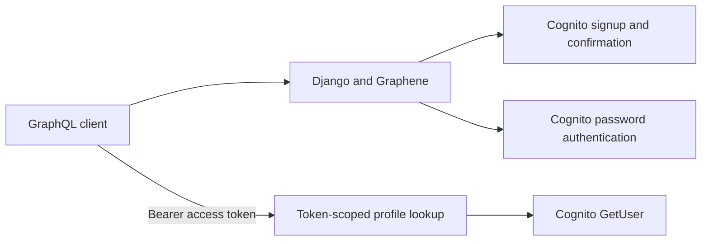

# Cognito identity API

A Django/Graphene demonstration of signup, confirmation-code verification, password sign-in, and authenticated profile lookup through Amazon Cognito. Despite the repository name, this snapshot contains identity flows rather than fitness tracking features.

## Identity boundary



`getUser(username: ...)` requires `Authorization: Bearer <access-token>`. The resolver obtains the caller's profile using Cognito `GetUser` and rejects a different requested username. It never uses a privileged `AdminGetUser` lookup. Sign-in also uses its returned access token to obtain profile attributes. Provider exceptions are replaced with a generic error message.

## Configure a local instance

```bash
python -m venv .venv
source .venv/bin/activate
pip install -r requirements.txt
cp fitness_tracker/.env.sample fitness_tracker/.env
python manage.py migrate
python manage.py runserver
```

Read `fitness_tracker/settings.py` for the environment-file location and required `COGNITO_*`/AWS settings. Replace sample values locally; do not commit credentials. Prefer short-lived AWS credentials and a least-privilege development pool. Set `DJANGO_SECRET_KEY` to keep sessions stable between processes. The temporary fallback is for local development.

The GraphQL endpoint is `/graphql/`. An authenticated query is:

```graphql
query {
  getUser(username: "your-cognito-username") {
    id
    username
    name
    email
  }
}
```

Signup, `confirmUser`, and `signin` are mutations defined in [accounts/schema.py](accounts/schema.py). Cognito must allow the configured `USER_PASSWORD_AUTH` flow. Additional authentication challenges currently produce an explicit error; the client does not implement an MFA/challenge continuation flow.

## Test without AWS

```bash
python -m unittest accounts.test_identity_boundary -v
```

Five mocked tests cover missing tokens, token-scoped identity, rejected cross-user lookup, sign-in profile retrieval, and redacted provider failures. They do not provision a pool, send email, validate IAM permissions, or prove a production deployment.

Before a shared deployment, restrict allowed hosts/origins, disable Django debug mode and public GraphiQL, add request throttling, and complete the challenge/refresh/sign-out lifecycle. The checked-in SQLite schema had no user or session rows and was removed; migrations recreate local state.
